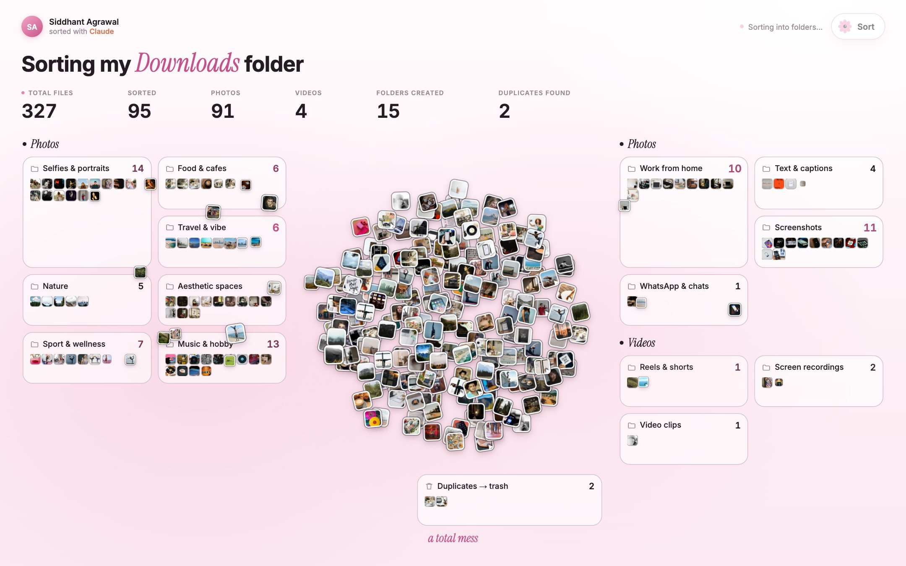
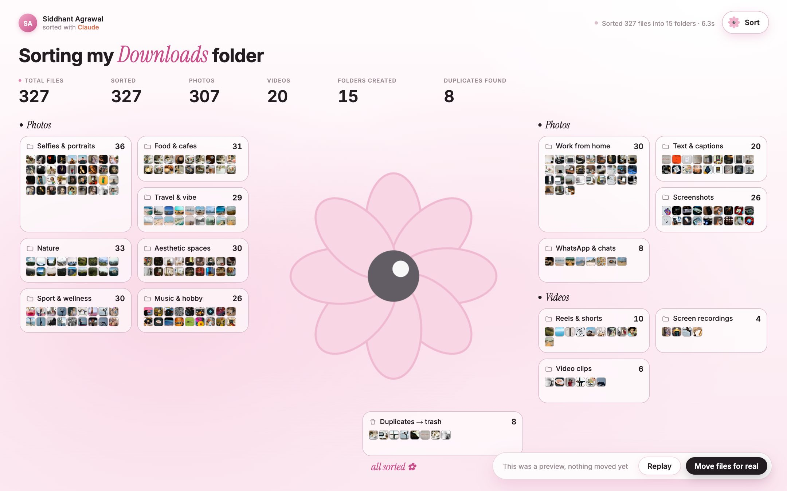

# Sort Studio

Watch your messy Downloads folder sort itself. Every file flies out of one big pile into neat folders, the counters tick up, and a flower blooms when it's done.




It runs on your own computer. Nothing is uploaded anywhere.

## Install (one line)

**Mac / Linux**: open Terminal and paste:

```bash
curl -fsSL https://raw.githubusercontent.com/GitSiddhantag/sort-studio/main/install.sh | bash
```

**Windows**: open PowerShell and paste:

```powershell
irm https://raw.githubusercontent.com/GitSiddhantag/sort-studio/main/install.ps1 | iex
```

It downloads Sort Studio into a `sort-studio` folder in your home folder and opens the page on your **Downloads** folder. Press **Sort** (or the space bar) and watch.

**Want a different folder?** Click the folder name in the title ("Sorting my *Downloads* ▾ folder") and pick Desktop, Pictures, Documents, or **Choose another folder…**

You need **Python 3**. Most Macs have it; if not, the installer tells you how to get it. On Windows, get it from [python.org](https://www.python.org/downloads/).

### Open it again later

```bash
python3 ~/sort-studio/sort.py
```

On a Mac you can also double-click **`Sort Downloads.command`** in that folder. The first time, macOS may block it: right-click it, choose **Open**, then **Open** again.

### Or with git

```bash
git clone https://github.com/GitSiddhantag/sort-studio.git
cd sort-studio
python3 sort.py
```

### Optional extras

- `pip3 install Pillow`: sharper photo thumbnails (needed on Windows and Linux).
- [ffmpeg](https://ffmpeg.org/download.html): thumbnails for video files.

## Is it safe?

**Pressing Sort only plays the animation. No files move.**

When it's done, a **Move files for real** button appears. Only if you click it *and* confirm are files moved, into sub-folders inside the same folder (`Downloads/Screenshots`, `Downloads/Food & cafes`, …).

- Nothing is ever deleted. Duplicates go into a `Duplicates (check, then delete)` folder for you to check.
- Files still downloading are left where they are.
- **Undo** puts every file back where it was. Each move is logged in `undo/`.
- Only files directly in the folder are sorted. Your existing sub-folders are left alone.

## Options

```bash
python3 sort.py ~/Desktop               # sort a different folder
python3 sort.py ~/Pictures --deep       # include sub-folders (preview only, can't move files)
python3 sort.py --owner "Your Name"     # name shown at the top (default: your computer account name)
python3 sort.py --port 9000             # use another port
```

Page shortcuts: **Space** sorts, **R** resets the pile. Add `?auto` to the address to start sorting as soon as the page opens, and `?speed=1.5` to slow the animation down (handy for screen recordings).

## How files are sorted

By rules, not AI. It looks at file names, types, image sizes, camera info and video shape and length:

- **Photos:** Screenshots, WhatsApp & chats, Camera photos, Social saves, Designs & graphics, Logos & icons, and topic folders such as Food & cafes, Travel & vibe, Nature, Selfies & portraits when the file name mentions them.
- **Videos:** Reels & shorts (vertical), Screen recordings, Video clips, Long videos.
- **Audio:** Voiceovers and Music & sound.
- **Files:** Documents, Invoices & receipts, Spreadsheets, Apps & installers, Zips, Code, Fonts.
- **Duplicates:** files with exactly the same content.

Want different folders? The rules are near the top of `sort.py` (`CATS` and the patterns under it).

## Built with

Plain Python (standard library) and a single HTML page. Made with [Claude Code](https://claude.com/claude-code).
Demo screenshots use photos from [Unsplash](https://unsplash.com).

## License

MIT
